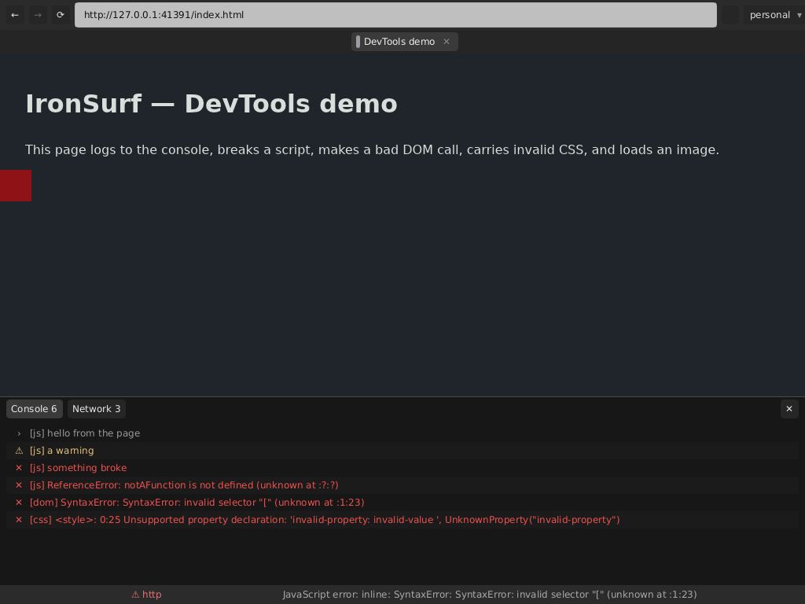
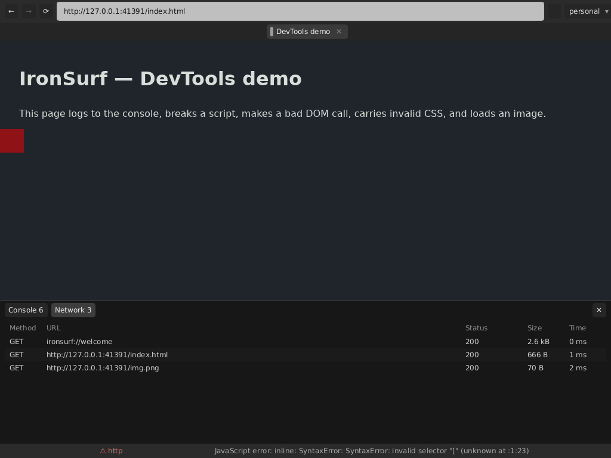

# IronSurf - A Browser Built in Rust

> **Windows edition.** This fork of [h4sh5/ironsurf](https://github.com/h4sh5/ironsurf)
> adds native Windows support — the same single `ironsurf.exe` — and a per-tab
> Windows sandbox (job objects, Low integrity, mitigation policies). See
> [Building (Windows)](#building-windows) and
> [the tab sandbox on Windows](#the-tab-sandbox-on-windows); builds are on the
> [Releases](https://github.com/JMTC-dev/ironsurf-windows/releases) page.
> Everything else is h4sh's IronSurf, described below.

This is a browser I am building using AI Agents. Almost none of the code is hand-written (altho this README.md does contain human writtten content).

Components: Boa for JS, Stylo for CSS, Blitz for HTML DOM. Slint for the UI.

It is still very experimental but notable features implemented so far include:
- tabs
- multi-account containers (like the firefox extension)
- userscripts
- dev tools console, network traffic and inspect element
- reader mode
- user agent switcher
- archive mode that saves every request automatically

This project aims to show that anyone can now build their own browser with AI to fit their own needs. No frontier model is needed; this codebase is largely written with Qwen 3.8 Flash Next running locally.

Eventually security auditing will be done a lot more and since rendering stack is fully Rust there should be way less memory based vulns than Chromium and Gecko which still use C++.

**Go build your own browser and help end the monopoly of Chromium!**


---------------

mostly AI gen'd text from this pt on

## Building (Debian)

```sh
apt install -y --no-install-recommends build-essential pkg-config git curl ca-certificates \
  libssl-dev libfontconfig-dev            # build-time
apt install -y --no-install-recommends libxkbcommon0 libxkbcommon-x11-0 libx11-xcb1 \
  libxcb1 libxcb-xkb1 libxi6 libxrender1 libxcursor1 libfontconfig1 fonts-dejavu-core  # run-time
cargo build --workspace && cargo test --workspace
```

The build produces **one** executable, `target/release/ironsurf`: the Slint
shell and the sandboxed per-tab Blitz/Boa host are linked into the same binary,
and the shell simply re-executes itself per tab (`ironsurf --tab-id …`). So a
release is one file to download and run — `./ironsurf` — and the tab half is
still a separate OS process per tab, only now it is a copy of the same binary.
Full prerequisite list, why each package is needed, and troubleshooting:
`docs/BUILD_DEBIAN.md`.

## Building (Windows)

Windows 10/11 x64 with [rustup](https://rustup.rs) (the default MSVC toolchain)
and the Visual Studio Build Tools' *Desktop development with C++* workload:

```powershell
cargo build --release --workspace
.\target\release\ironsurf.exe
```

It is the same single `ironsurf.exe` (shell + per-tab host). Double-clicked it
opens just the browser window; run from a terminal it keeps the console, so
`--log debug --tab-stderr` works as on Linux.

- **Smart App Control** blocks unsigned programs it has no reputation for —
  including every build script cargo compiles (`os error 4551`) and an
  unsigned downloaded `ironsurf.exe`. Building or running IronSurf needs it
  off (Windows Security → App & browser control).
- **Data** lives in `%USERPROFILE%\.local\share\ironsurf` (or
  `IRONSURF_DATA_DIR`); downloads and the archive default to
  `%USERPROFILE%\Downloads`.
- **Archive mode** spells names Windows can store: the timestamp folder uses
  `-` for `:` (`2026-09-17T07-20-48+10-00`), and `: ? * < > | " %` inside
  archived names are percent-escaped (`127.0.0.1%3A8000`, `search%3Fq=x`).

### The tab sandbox on Windows

Every tab starts **suspended inside its own job object** and only then runs:
the job kills it with the shell, allows no second process, caps its memory
(4 GiB committed) and keeps it off the desktop and clipboard. Before it
touches any web content the tab then locks itself down:

- **Low integrity** — no writes anywhere but its own container profile
  (labelled Low on first use), not to the user's files, the registry or
  other processes;
- **mitigation policies** — no dynamic code (ACG: Boa is an interpreter, so
  nothing in a tab ever needs executable memory), no child processes, no
  extension-point DLLs, no remote or Low-labelled DLLs, strict handle checks,
  system fonts only for GDI.

Not covered yet: Low integrity does not stop *reads*, and every tab shares
the Low label, so one container's tab could write into another's profile.
Both need an AppContainer per container (it can only be chosen when the
process is created). `--no-sandbox` turns the tab half off;
`IRONSURF_SANDBOX_SKIP=no-dynamic-code,low-integrity,…` leaves single layers
off while debugging.

## Debugging (stderr diagnostics)

Everything the browser knows goes to **stderr** — never stdout, which is the
binary IPC channel between the shell and a tab.

```sh
IRONSURF_LOG=debug ironsurf --tab-stderr   # shell + every tab, interleaved
ironsurf --log trace                      # + frames, pointer events, IPC noise
ironsurf --log off                        # quiet
```

`off|error|warn|info|debug|trace` (default `info`); `--log`/`-v` win over
`IRONSURF_LOG`, which wins over `RUST_LOG`. Lines look like
`[14:22:07.418] INFO tab 3 runtime: url -> https://example.com/`. URL changes,
load start/finish, tab spawn/exit and page `console.*`/JS errors are all there —
`docs/ENGINE_INTEGRATION.md` §F lists every site and why the noisy ones sit at
`trace` (a tab's stderr is a pipe nobody reads).

## Developer tools

`F12` or `Ctrl-I` toggles a per-tab DevTools panel docked over the bottom of the page:



- **Console** — `console.log/info/warn/error`, uncaught JS exceptions, invalid CSS, and
  native DOM binding throws, each line tagged with its source (`[js]`, `[css]`, `[dom]`)
  and coloured by level.
- **Network** — one row per request the page made: method, URL, status, size and time
  (`—` where the engine could not measure something; failed requests show their error text
  in red instead of a status). Redirect hops appear as separate rows.
  

Honest limitations: Blitz hands Stylo no parse-error reporter, so the console's CSS entries
come from the tab re-parsing `<style>` blocks and inline `style` attributes itself —
parse errors *inside* `<link rel=stylesheet>` files (and `@import` bodies) are invisible
today (their load failures and wrong `Content-Type`s do show up). Font/bidi traces stay on
stderr (`--log trace`), not in the panel.

`scripts/demo.sh` reproduces both screenshots on a headless X display with a localhost fixture.

## Userscripts

The `</>` button in the top bar opens the userscript menu:


- Each entry runs its JavaScript on matching pages (URL patterns with `*` wildcards, e.g.
  `*://*.example.com/*`, `example.org/docs`), in the page's own realm — real DOM, dialogs,
  navigation — after the page's own `<script>`s, in menu order.
- The enable checkbox flips a script off everywhere at once (disabled scripts are never
  even sent to a tab); ✕ deletes it; clicking the row edits it in place (same id, same
  `enabled` flag). A throwing script only kills itself: its name and error land in the
  DevTools console tagged `[userscript]`, the tab keeps running.
- Scripts live in `~/.local/share/ironsurf/userscripts.json` (next to the container
  registry), so they survive restarts; edits reach every open tab immediately.

## Per-container User-Agent

The `UA` button in the top bar (right of `</>`) switches the `User-Agent` **per container**:

- The menu lists *Default (IronSurf)* and the built-in presets — Firefox, Chrome, Bingbot,
  Googlebot, Android Chrome — with the active container's current choice highlighted; a
  custom field takes any arbitrary string (shown as *Custom* on the button).
- The choice belongs to the **active tab's container** only: every later request from tabs
  in that container — documents, form POSTs, redirect hops, subresources, media — carries
  that string, and `navigator.userAgent` updates live without a reload. Other containers
  keep their own value (or the default).
- It is stored with the container in `~/.local/share/ironsurf/containers.json`, so newly
  opened (or respawned) tabs in that container launch with it already applied.

## Archive mode

The 💾 button in the top bar (right of `UA`) opens the **Archive mode** menu — off by default:

- With the mode **on**, every website a tab visits and every file it loads from that site —
  documents, scripts, stylesheets, images, media — is saved to the archive folder as it
  arrives. Nothing is written inside the tab process; the tab ships the bytes and the
  shell writes them.
- The tree is `<folder>/<timestamp>/<host[:port]>/…`, e.g.
  `ironsurf-tabs/2026-09-17T07:20:48+10:00/example.com/index.html` and
  `…/example.com/js/app.js`. Visited pages become the host's `index.html`; subresources
  keep their URL path (query strings stripped). The timestamp is the **tab process's
  spawn instant** (ISO 8601, local time with UTC offset), taken once per tab — so a
  later browsing session lands in its own folder and never overwrites an earlier one.
  Tabs that were already open when the mode switches on start a fresh timestamp folder
  from that moment.
- The folder is configurable in the same menu (default `$HOME/Downloads/ironsurf-tabs`;
  `~` expands, absolute paths only, created on demand) and both the folder and the
  switch persist across restarts (`~/.local/share/ironsurf/ui.json`). Tabs spawned
  while the mode is on archive from their very first fetch.

## Feedback

Feel free to help out, fork, spend some tokens on it. The initial Proof of Concept build (this repo) is built entirely from locally-hosted Qwen 3.8 Flash Next.

